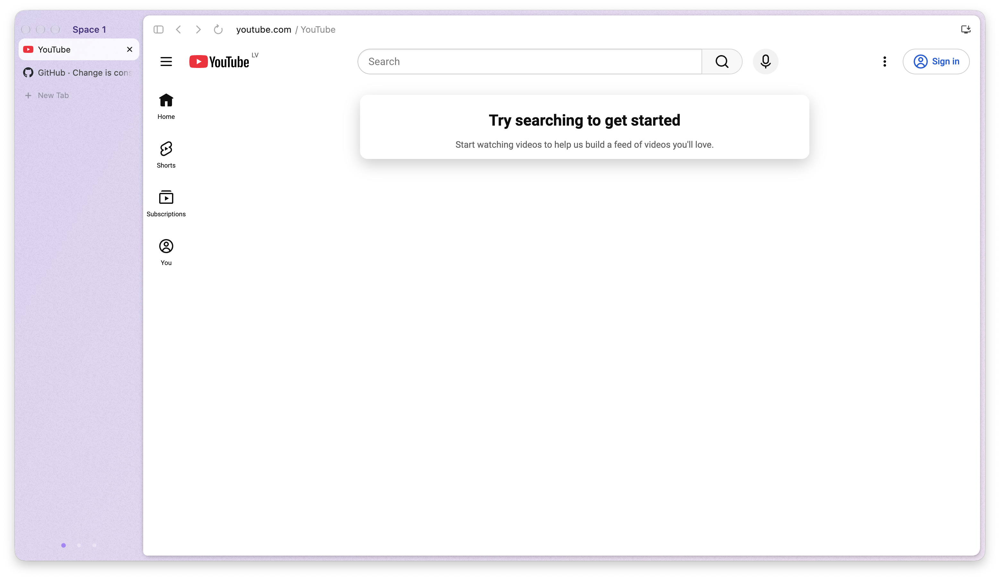

<p align="center">
  
</p>

<h1 align="center">Biba</h1>

<p align="center">
  A calm, fast browser with Spaces, a sidebar and no AI.<br>
  <b>Beta.</b> Vibecoded fork of <a href="https://github.com/imputnet/helium">Helium</a> (ungoogled Chromium).
</p>

<p align="center">
  
</p>

---

## Why this exists

Arc is gone. Dia, its successor, turned the browser into an AI product: chat in
every corner, your tabs sent off as "context", telemetry from half a dozen
vendors. We liked how Arc and Dia *felt* — the sidebar, Spaces, the calm card
the web sits in — and wanted that without the AI and without the tracking.

So Biba is that: the layout and the feel, on top of Helium, which already
strips Google services and telemetry out of Chromium.

**This browser was vibecoded.** It was built in a few long sessions by one
person and Claude (Anthropic's AI), patch by patch, on top of Helium. Expect
rough edges. It is a beta — use it, break it, open issues.

## What's different from Helium

- **Spaces.** Separate sets of tabs in one window, each with its own colour.
  Switch with a two-finger swipe on the sidebar, the dots at the bottom, the
  Space name next to the traffic lights, or ⌘⌥1…9. Inactive Spaces are
  frozen (no JS, no timers) to save memory and battery, and are restored after
  a restart.
- **The sidebar.** Vertical tabs with roomy rows, pinned sites as tiles at the
  top, hover a tab to close it or copy its link. Drag a tab up to pin it, down
  to unpin, or onto a Space dot to move it there. ⌘S hides the sidebar (or
  collapses it to icons — your choice in Settings › Appearance).
- **The page is a card.** Toolbar and page float as one rounded card over a
  softly tinted window. The toolbar takes the colour of the page it shows.
- **A quiet toolbar.** "domain / page title", thin icons, no star, no install
  prompts. Extension icons can be greyed out to match (Settings › Appearance).
- **⌘T** opens a new tab with a centred search box: type an address or a
  search, press Return. Just search — no AI.
- **No AI anywhere.** Nothing to opt out of.
- **Updates** via GitHub Releases (Sparkle, signed).

Everything else — the privacy work, uBlock Origin, the settings — is Helium's.
Huge thanks to the Helium and ungoogled-chromium people.

## Status

Beta, macOS (Apple Silicon) first. Things that are still rough:

- Tab drag between the tiles and the list can still flicker.
- Pinned *links* (Dia-style rows above a divider) are not done yet.
- No Windows/Linux builds yet.

## Install

Grab the latest `.dmg` from
[Releases](https://github.com/weristvlad/biba-browser/releases), drag Biba to
Applications. Biba checks for updates on its own.

## Building

Biba is a set of patches applied after Helium's, so you build it the way you
build [helium-macos](https://github.com/imputnet/helium-macos):

1. Check out helium-macos and run its setup until Helium's patches are applied.
2. Link this repo's patches into it and append them to the series:
   ```sh
   ln -s "$PWD/patches/biba" helium-macos/patches/biba
   grep -v '^#' patches/series >> helium-macos/patches/series.merged
   ```
3. Apply them (`scripts/q push -a` is a small quilt wrapper; set
   `BIBA_HELIUM=/path/to/helium-macos`).
4. Copy the branding: `resources/build_resources.sh`, then each line of
   `resources/biba_resources.txt` maps a generated file to its place in the
   Chromium tree.
5. Build: `scripts/build-helium.sh <jobs> <nice>`.

The Chromium tree is ~100 GB; a full build takes hours.

## Repository layout

| Path | What |
|---|---|
| `patches/biba/*.patch` | Biba's changes to Chromium/Helium, one feature per patch |
| `patches/series` | The order they apply in |
| `resources/` | Logo and the icon pipeline |
| `scripts/` | Build and dev helpers |
| `site/` | biba website |

## License

GPL-3.0, same as Helium. See [LICENSE](LICENSE).

Biba is not affiliated with The Browser Company, Arc or Dia. No code or assets
from them are used; the look is our own take on the idea.

---

<sub>Made by [@weristvlad](https://github.com/weristvlad) with Claude.</sub>
